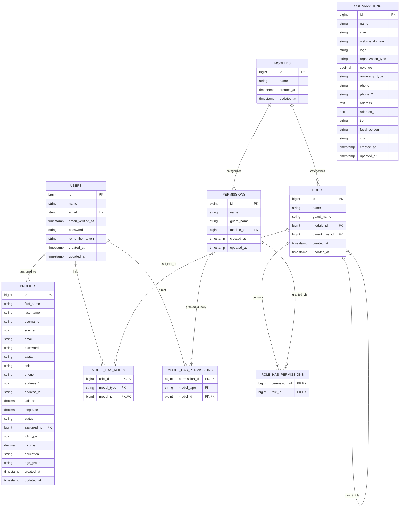

# Project Documentation & Technical Specification
**File:** `README-UPDATED-5OCTOBER.md`  
**Application:** CORK Enterprise CRM & RBAC Dashboard  
**Framework:** Laravel (v11/v12) | PHP 8.2+ | MySQL  
**Frontend Stack:** Tailwind CSS, Bootstrap 5 (Hybrid Modal System), jQuery 3.7.1, Yajra DataTables  
**Security & Access Control:** Spatie Laravel-Permission (Role-Based & Direct Access Control)  
**Last Updated:** October 5, 2026  

---

## Table of Contents
1. [System Design & Architecture](#1-system-design--architecture)
2. [Use Cases & System Overflow](#2-use-cases--system-overflow)
3. [Functional & Non-Functional Requirements](#3-functional--non-functional-requirements)
4. [Step-by-Step Entity Relationship Diagram (ERD)](#4-step-by-step-entity-relationship-diagram-erd)
5. [Detailed Explanation of All Models](#5-detailed-explanation-of-all-models)
6. [Detailed Explanation of All Controllers](#6-detailed-explanation-of-all-controllers)
7. [Detailed Explanation of All Views & Layouts](#7-detailed-explanation-of-all-views--layouts)
8. [Upcoming Steps & Roadmap (Next Phase Milestones)](#8-upcoming-steps--roadmap-next-phase-milestones)

---

## 1. System Design & Architecture

### 1.1 Architectural Pattern
The application is built on the classic **Model-View-Controller (MVC)** architectural pattern, enriched with:
- **Service & Repository Delegation**: Complex querying and server-side processing are decoupled using Yajra DataTables pipelines.
- **Role-Based Access Control (RBAC)**: Powered by Spatie Laravel-Permission, extended with custom hierarchical role trees (`parent_role_id`) and module grouping (`module_id`).
- **Hybrid CSS & Component Architecture**:
  - **Outer Frame & Pages**: Lightweight, responsive **Tailwind CSS** with full dark-mode support (`class="dark"`).
  - **Modal Forms**: **Bootstrap 5 Dialogs** customized with sticky headers/footers and distinct internal scrollable bodies (`max-height: 70vh; overflow-y: auto`), preventing modal cutoff on varying screen resolutions.
  - **Dark Theme Synchronizer**: Synchronizes `html.dark` and `data-bs-theme="dark"` attributes via `localStorage('cork-theme')` across both Tailwind and Bootstrap components.

```
+-----------------------------------------------------------------------------------+
|                                 CLIENT / BROWSER                                  |
|   Tailwind CSS Shell  |  Bootstrap 5 Modals  |  Yajra DataTables  |  jQuery AJAX  |
+------------------------------------------+----------------------------------------+
                                           | HTTP Requests / AJAX (CSRF-Protected)
                                           v
+-----------------------------------------------------------------------------------+
|                                LARAVEL BACKEND                                    |
|  [routes/web.php] ---> [Auth & Role Middleware] ---> [Controllers]                 |
|                                                            |                      |
|                                                            v                      |
|                                                  [Eloquent Models & Spatie]       |
+------------------------------------------------------------+----------------------+
                                                             | Queries / Transactions
                                                             v
+-----------------------------------------------------------------------------------+
|                                 DATABASE (MySQL)                                  |
|  users | profiles | organizations | modules | roles | permissions | Spatie Pivots |
+-----------------------------------------------------------------------------------+
```

### 1.2 Data Flow & Request Lifecycle
1. **Request Dispatching**: The browser initiates either a standard HTTP navigation or an asynchronous jQuery AJAX request (`GET`, `POST`, `PUT`, `DELETE`).
2. **Security & Session Validation**: Handled by Laravel's `auth` middleware group. All mutating requests enforce `X-CSRF-TOKEN` headers.
3. **Controller Execution**:
   - **Page Render**: Returns compiled Blade templates extending `backend.layouts.master`.
   - **DataTables Processing**: Fetches database records via Eloquent queries, applies server-side search, filtering, and custom column badges, returning structured JSON (`DT_RowIndex`, action buttons, formatted dates).
   - **Mutations (Store / Update / Destroy)**: Validates incoming payloads via `Validator::make` with strict regex and uniqueness constraints, performs database writes, flushes cached permissions via `app(PermissionRegistrar::class)->forgetCachedPermissions()`, and returns standard `{ status: true, message: "..." }` responses.

---

## 2. Use Cases & System Overflow

### 2.1 Use Case Breakdown

#### UC-1: Authentication & Session Management
- **Actor**: Guest / Authenticated User
- **Description**: Users register with unique credentials or log into the administrative portal. Sessions are securely persisted, and authentication guards redirect unauthenticated requests to `/login`.

#### UC-2: Profiles Management
- **Actor**: Administrator / Staff
- **Description**: Manage individual customer or lead profiles.
- **Overflow**:
  1. User navigates to `/profiles`.
  2. DataTables renders profiles asynchronously with server-side sorting and search. The table intentionally excludes the CNIC column for visual cleanliness.
  3. Clicking "+ Add Profile" opens a Bootstrap modal with a scrollable container.
  4. The form validates that CNIC is exactly 13 digits (`^[0-9]{13}$`) and Phone is exactly 11 digits (`^[0-9]{11}$`).
  5. Profile photos are uploaded, stored in `public/uploads/profiles`, and previewed in real-time.
  6. Profiles can be edited, viewed in full detail, or deleted with cascade cleanup.

#### UC-3: Organizations Management
- **Actor**: Administrator / Manager
- **Description**: Manage corporate client accounts, company tiers, and business demographics.
- **Overflow**:
  1. User navigates to `/organizations`.
  2. DataTables loads organizations with formatted revenue, company tier, and ownership type.
  3. Add/Edit modal provides dual phone numbers, address fields, focal person, and a 13-digit CNIC field for company representatives.
  4. Corporate logos are uploaded to `public/uploads/organizations` with fallback UI Avatars.

#### UC-4: Roles & Role-Permission Matrix
- **Actor**: Administrator / Super Admin
- **Description**: Define system roles, nest them under parent roles, categorize them under business modules, and grant permissions via a visual module-based checklist.
- **Overflow**:
  1. User navigates to `/roles`.
  2. Table shows role name, module category, parent role, and permission count.
  3. "Manage Permissions" opens a modal displaying permissions grouped by modules with "Select All" toggles.
  4. Submitting syncs permissions using Spatie's `syncPermissions` method and invalidates cached authorization gates.

#### UC-5: Direct User Permission Assignments (Assignment Page)
- **Actor**: Super Admin / Administrator
- **Description**: Assign or revoke direct, user-level permissions on top of existing role permissions.
- **Overflow**:
  1. User clicks "Assignment" in the sidebar (`/assignments`).
  2. Table displays all users, their assigned roles, direct permission counts, and action buttons.
  3. **Super Admin Protection**: Super Admins are displayed with an `All` badge; their permissions cannot be altered from this screen, and they cannot be deleted.
  4. Non-superadmin users have two action buttons: **Manage Permissions Icon** (`manage-perm-btn`) and **Delete Icon** (`delete-user-btn`). The "Edit User" button is removed.
  5. Clicking the permissions icon opens a modal listing all permissions grouped by modules. Permissions already inherited from the user's role are disabled and flagged with `(via role)` so only direct overrides are toggled.

#### UC-6: Dedicated Permissions Management
- **Actor**: Super Admin / Administrator
- **Description**: Create, edit, and delete permissions categorized under modules.
- **Overflow**:
  1. User clicks "Permissions" directly under "Assignment" in the sidebar (`/permissions`).
  2. Table shows Permission Name, Module Category, Guard, and Creation Date.
  3. Adding a permission requires both a unique `name` and a selection from the `module_id` dropdown.
  4. Editing a permission allows changing both the name and re-assigning it to a different module.
  5. Deleting a permission clears it from all roles, direct user assignments, and flushes Spatie cache.

---

## 3. Functional & Non-Functional Requirements

### 3.1 Functional Requirements

| Ref # | Feature / Module | Functional Requirement Specification |
|---|---|---|
| **FR-01** | Auth | User registration, login with hashed passwords (`bcrypt`), session preservation, and secure logout. |
| **FR-02** | Profile CRUD | Full AJAX CRUD for customer/staff profiles with avatar image processing. |
| **FR-03** | Profile Validation | CNIC strictly enforced at 13 numeric digits (`digits:13`). Phone strictly enforced at 11 digits (`digits:11`). |
| **FR-04** | Organization CRUD | Full AJAX CRUD for organizations with logo uploading, focal person tracking, and representative CNIC. |
| **FR-05** | Role Hierarchy | Roles can optionally belong to a `module_id` and have a `parent_role_id` for reporting structures. |
| **FR-06** | Role Permission Sync | Bulk assign permissions to roles grouped by modules with single-click "Select All" toggling. |
| **FR-07** | Direct Permission Assignment | Assign individual permissions directly to users; calculate and display direct permissions count badge. |
| **FR-08** | Superadmin Protection | User with role `superadmin` or `super-admin` is protected from deletion, direct permission override, or role demotion. |
| **FR-09** | Dedicated Permission CRUD | Create new permissions with required module classification; update permission names and re-categorize modules. |
| **FR-10** | Table Column Sanitization | CNIC is removed from list tables (Yajra view) while remaining fully editable and visible in modals. |

### 3.2 Non-Functional Requirements

| Category | Requirement Specification |
|---|---|
| **Security** | CSRF protection on all AJAX state mutations (`X-CSRF-TOKEN`); SQL injection prevention via Eloquent parameter binding; route protection via `auth` middleware. |
| **Performance** | Server-side DataTables pagination and search to support large datasets without client-side lag; Spatie authorization cache invalidation on edits. |
| **Usability & UX** | Modal bodies with independent scrollbars (`max-height: 70vh`) ensuring action buttons remain visible; visual feedback toasts; confirmation prompts before destructive actions. |
| **Theme Consistency** | Dynamic dark/light mode toggle with persistent state across all screens; tailored dark mode contrast for badges, table rows, and inputs. |
| **Extensibility** | Normalized database schema linking permissions and roles to a centralized `modules` entity. |

---

## 4. Step-by-Step Entity Relationship Diagram (ERD)

### 4.1 Mermaid ERD Schema



### 4.2 Relationship Narrative
1. **`users` to `profiles` (1:N)**: A user (such as a sales manager or agent) can have multiple customer profiles assigned to them via `profiles.assigned_to -> users.id`.
2. **`modules` to `roles` (1:N)**: Each role can belong to a functional module (e.g. Sales, Finance, Administration) via `roles.module_id -> modules.id`.
3. **`modules` to `permissions` (1:N)**: Every permission belongs to a module category via `permissions.module_id -> modules.id`.
4. **`roles` to `roles` (Self-referencing 1:N)**: Roles can form an organizational tree where a role reports to another role via `roles.parent_role_id -> roles.id`.
5. **`roles` and `permissions` (M:N via `role_has_permissions`)**: Standard Spatie junction mapping multiple permissions to multiple roles.
6. **`users` and `roles` (M:N via `model_has_roles`)**: Polymorphic association assigning one or more roles to a user.
7. **`users` and `permissions` (M:N via `model_has_permissions`)**: Direct permission overrides granting specific permissions to an individual user independent of their role.

---

## 5. Detailed Explanation of All Models

### 5.1 `User` ([`app/Models/User.php`](file:///d:/laravel/SEPT291/SEPT24/app/Models/User.php))
- **Base Class**: `Illuminate\Foundation\Auth\User`
- **Traits Used**: `HasFactory`, `Notifiable`, `Spatie\Permission\Traits\HasRoles`
- **Attributes**:
  - `$fillable`: `['name', 'email', 'password']`
  - `$hidden`: `['password', 'remember_token']`
  - `$casts`: `email_verified_at => 'datetime'`, `password => 'hashed'`
- **Relationships**:
  - `assignedProfiles()`: `hasMany(Profile::class, 'assigned_to')`
  - Spatie Methods: `roles()`, `permissions()`, `hasRole()`, `syncRoles()`, `syncPermissions()`, `getPermissionsViaRoles()`.

### 5.2 `Role` ([`app/Models/Role.php`](file:///d:/laravel/SEPT291/SEPT24/app/Models/Role.php))
- **Base Class**: `Spatie\Permission\Models\Role`
- **Attributes**:
  - `$fillable`: `['name', 'guard_name', 'module_id', 'parent_role_id']`
- **Relationships**:
  - `module()`: `belongsTo(Module::class)` - Associates role with a system module.
  - `parentRole()`: `belongsTo(Role::class, 'parent_role_id')` - Defines immediate supervisor/parent role.
  - `childRoles()`: `hasMany(Role::class, 'parent_role_id')` - Retrieves all subordinate roles.

### 5.3 `Permission` ([`app/Models/Permission.php`](file:///d:/laravel/SEPT291/SEPT24/app/Models/Permission.php))
- **Base Class**: `Spatie\Permission\Models\Permission`
- **Attributes**:
  - `$fillable`: `['name', 'guard_name', 'module_id']`
- **Relationships**:
  - `module()`: `belongsTo(Module::class)` - Links permission directly to its parent functional module for structured grouping.

### 5.4 `Module` ([`app/Models/Module.php`](file:///d:/laravel/SEPT291/SEPT24/app/Models/Module.php))
- **Base Class**: `Illuminate\Database\Eloquent\Model`
- **Attributes**:
  - `$fillable`: `['name']`
- **Relationships**:
  - `roles()`: `hasMany(Role::class)` - Roles associated with this module.
  - `permissions()`: `hasMany(Permission::class)` - Permissions categorized under this module.

### 5.5 `Profile` ([`app/Models/Profile.php`](file:///d:/laravel/SEPT291/SEPT24/app/Models/Profile.php))
- **Base Class**: `Illuminate\Database\Eloquent\Model`
- **Attributes**:
  - `$fillable`: `['first_name', 'last_name', 'username', 'source', 'email', 'password', 'avatar', 'cnic', 'phone', 'address_1', 'address_2', 'latitude', 'longitude', 'status', 'assigned_to', 'job_type', 'income', 'education', 'age_group']`
  - `$hidden`: `['password']`
- **Accessors**:
  - `getFullNameAttribute()`: Combines `first_name` and `last_name`.
  - `getAvatarUrlAttribute()`: Checks for local file in `public/uploads/profiles` or falls back to UI Avatars.
- **Relationships**:
  - `assignedUser()`: `belongsTo(User::class, 'assigned_to')` - The employee/staff member managing this profile.

### 5.6 `Organization` ([`app/Models/Organization.php`](file:///d:/laravel/SEPT291/SEPT24/app/Models/Organization.php))
- **Base Class**: `Illuminate\Database\Eloquent\Model`
- **Attributes**:
  - `$fillable`: `['name', 'size', 'website_domain', 'logo', 'organization_type', 'revenue', 'ownership_type', 'phone', 'phone_2', 'address', 'address_2', 'tier', 'focal_person', 'cnic']`
- **Accessors**:
  - `getLogoUrlAttribute()`: Returns local logo asset URL or dynamic UI Avatar.
  - `getFormattedRevenueAttribute()`: Formats numeric revenue into currency format (e.g. `$1,500,000.00`).

---

## 6. Detailed Explanation of All Controllers

### 6.1 `PermissionController` ([`app/Http/Controllers/PermissionController.php`](file:///d:/laravel/SEPT291/SEPT24/app/Http/Controllers/PermissionController.php))
Dedicated controller for permissions catalog management.
- **`index()`**: Fetches all `Module::orderBy('name')->get()` and renders `backend.permissions.index`.
- **`data(Request $request)`**: Yajra DataTables provider returning permission name, module badge with custom join for sorting/filtering, guard badge, created date, and action buttons (`edit-perm-btn`, `delete-perm-btn`).
- **`store(Request $request)`**: Validates uniqueness and module existence (`'name' => 'required|string|max:191|unique:permissions,name'`, `'module_id' => 'required|exists:modules,id'`), creates permission under the module, and clears Spatie cache.
- **`edit(int $id)`**: Returns permission details including its module as JSON.
- **`update(Request $request, int $id)`**: Updates permission name and enables moving it to a different module (`Rule::unique('permissions', 'name')->ignore($id)`), invalidating Spatie cache.
- **`destroy(int $id)`**: Deletes the permission and purges Spatie permission cache.

### 6.2 `SimplePermissionController` ([`app/Http/Controllers/SimplePermissionController.php`](file:///d:/laravel/SEPT291/SEPT24/app/Http/Controllers/SimplePermissionController.php))
Controller for User Direct Permission Assignments.
- **`index()`**: Renders `backend.permissions.simple-permissions`.
- **`isProtected(User $user)`**: Helper method verifying if a user has `superadmin` or `super-admin` roles.
- **`data(Request $request)`**:
  - Generates DataTables feed of users.
  - Generates `permissions_count`: returns `'All'` badge for protected superadmins; returns direct permission count for normal users with responsive dark/light colors.
  - Generates `action`: returns protected badge for superadmins; renders **only** the `manage-perm-btn` (permissions icon) and `delete-user-btn` (delete icon) for other users.
- **`permissions(int $id)`**: Builds a matrix of modules and permissions for a user. Distinguishes direct permissions (`checked: true`) from permissions inherited via role (`via_role: true, disabled`).
- **`savePermissions(Request $request, int $id)`**: Synchronizes direct permissions for the user using `$user->syncPermissions()` and calls `forgetCachedPermissions()`.
- **`destroy(int $id)`**: Deletes user while preventing self-deletion and superadmin deletion.

### 6.3 `RolePermissionController` ([`app/Http/Controllers/RolePermissionController.php`](file:///d:/laravel/SEPT291/SEPT24/app/Http/Controllers/RolePermissionController.php))
Manages system roles and their permission matrix.
- **`index()`**: Renders `backend.roles.index` with modules and existing roles.
- **`data()`**: Yajra DataTables provider returning role list, module badge, parent role name, permission count badge, and actions (Edit, Permissions, Delete).
- **`store()` / `update()`**: Creates or updates role names with optional `module_id` and `parent_role_id`.
- **`permissions($id)` / `savePermissions($id)`**: Fetches and syncs role-level permissions grouped by module.
- **`destroy($id)`**: Safely removes role, preventing deletion of protected roles (`super-admin`, `superadmin`).

### 6.4 `ProfileController` ([`app/Http/Controllers/ProfileController.php`](file:///d:/laravel/SEPT291/SEPT24/app/Http/Controllers/ProfileController.php))
Full-featured customer and staff profile management.
- **`data()`**: Returns DataTables JSON. Includes sorting and search across name, email, phone, status, and assigned user. **Intentionally does not return CNIC in table columns** for layout ergonomics.
- **`store()` / `update()`**: Validates input:
  - `cnic`: `'required|string|size:13|regex:/^[0-9]{13}$/'`
  - `phone`: `'required|string|size:11|regex:/^[0-9]{11}$/'`
  - Handles image upload and stores in `uploads/profiles/`.
- **`show()`**: Returns full profile model with avatar URL and assigned user for modal inspection.
- **`destroy()`**: Deletes record and unlinks avatar image file.

### 6.5 `OrganizationController` ([`app/Http/Controllers/OrganizationController.php`](file:///d:/laravel/SEPT291/SEPT24/app/Http/Controllers/OrganizationController.php))
Corporate client and organization management.
- **`data()`**: DataTables provider returning organization name, domain, tier, revenue, and contact numbers.
- **`store()` / `update()`**: Validates representative CNIC (13 digits), primary phone (11 digits), secondary phone (11 digits), and stores corporate logos in `uploads/organizations/`.
- **`show()` / `destroy()`**: Handles organization detail inspection and deletion.

### 6.6 `LoginController` & `RegisterController`
- Located in [`app/Http/Controllers/Auth/`](file:///d:/laravel/SEPT291/SEPT24/app/Http/Controllers/Auth).
- Handles user registration, credentials hashing, authentication sessions, and logout flows.

---

## 7. Detailed Explanation of All Views & Layouts

### 7.1 Layout Components

#### `master.blade.php` ([`resources/views/backend/layouts/master.blade.php`](file:///d:/laravel/SEPT291/SEPT24/resources/views/backend/layouts/master.blade.php))
- Main application shell rendering HTML5 boilerplate, Google fonts, Tailwind CSS CDN with dark mode config, and Bootstrap 5 assets.
- **CSRF Token**: Injects `<meta name="csrf-token" content="{{ csrf_token() }}">` into `<head>` for global AJAX consumption.
- **CSS Grid Shell (`#shell`)**: Modern multi-area layout (`sidebar navbar`, `sidebar content`, `sidebar footer`) with responsive collapse transitions (`var(--sidebar-w)`).
- **Theme Bootstrap**: Inline IIFE script executing before DOM render to prevent theme flashing between light and dark modes.

#### `navbar.blade.php` ([`resources/views/backend/layouts/navbar.blade.php`](file:///d:/laravel/SEPT291/SEPT24/resources/views/backend/layouts/navbar.blade.php))
- Top header with search bar, notification indicators, user profile dropdown, and the **Dark Mode Toggle Button**.
- Synchronizes `classList.toggle('dark')` and `setAttribute('data-bs-theme', 'dark')` on `document.documentElement` and stores state in `localStorage`.

#### `sidebar.blade.php` ([`resources/views/backend/layouts/sidebar.blade.php`](file:///d:/laravel/SEPT291/SEPT24/resources/views/backend/layouts/sidebar.blade.php))
- Brand logo and main navigation links.
- Collapsible `<details id="adminPanel">` dropdown with state persistence. Automatically stays open when on `users1.*`, `roles.*`, `assignments.*`, or `permissions.*` routes.
- **Updated Navigation Links**:
  - `Profiles` (`route('profiles.index')`)
  - `Organizations` (`route('organizations.index')`)
  - `Users Management` (`route('users1.index')`)
  - `Roles Management` (`route('roles.index')`)
  - `Assignment` (`route('assignments.index')`)
  - `Permissions` (`route('permissions.index')`) positioned directly under Assignment.

#### `footer.blade.php` ([`resources/views/backend/layouts/footer.blade.php`](file:///d:/laravel/SEPT291/SEPT24/resources/views/backend/layouts/footer.blade.php))
- Minimal, clean copyright and status bar.

---

### 7.2 Backend Feature Views

#### `backend.permissions.index` ([`resources/views/backend/permissions/index.blade.php`](file:///d:/laravel/SEPT291/SEPT24/resources/views/backend/permissions/index.blade.php))
- Dedicated page for managing system permissions.
- **Header**: Action bar with title, direct link to Assignments, and "+ Add Permission" button.
- **Table Card**: Yajra DataTables loading columns: `#`, `Permission Name` (with key icon badge), `Module Category` (pill badge), `Guard`, `Created At`, and action buttons (`Edit` and `Delete`).
- **Modal Dialog**:
  - Permission Name input with regex/format hints.
  - Required **Module Category** dropdown populated dynamically from `$modules`.
  - Inline error feedback containers (`#permNameErr`, `#permModuleErr`).
  - Loading spinner state on save button.
- **Interactive Scripts**:
  - Full AJAX CRUD with automatic table refresh.
  - Dynamic toast notification system for user feedback.

#### `backend.permissions.simple-permissions` ([`resources/views/backend/permissions/simple-permissions.blade.php`](file:///d:/laravel/SEPT291/SEPT24/resources/views/backend/permissions/simple-permissions.blade.php))
- Direct Permission Assignments screen.
- **Columns**: `Id`, `Name`, `Email`, `Role`, `Direct Permissions`, `Action`.
- **Action Column**: Renders **only** the `manage-perm-btn` (shield icon) and `delete-user-btn` (trash icon).
- **Direct Permissions Modal**:
  - Lists all system permissions grouped into modular boxes.
  - "Select All" toggle per module.
  - Permissions granted via user's role are greyed out and marked with `(via role)` so they cannot be deselect-broken from this screen.
  - Live count indicator: `<span id="permSelectedCount">0</span> direct permission(s) selected`.

#### `backend.roles.index` ([`resources/views/backend/roles/index.blade.php`](file:///d:/laravel/SEPT291/SEPT24/resources/views/backend/roles/index.blade.php))
- Roles list with hierarchical indicators and module categorization.
- Role creation modal with optional parent role dropdown and module selection.
- Permissions matrix modal for assigning permissions to roles.

#### `backend.profiles.index` ([`resources/views/backend/profiles/index.blade.php`](file:///d:/laravel/SEPT291/SEPT24/resources/views/backend/profiles/index.blade.php))
- Hybrid Tailwind + Bootstrap design.
- DataTables view omitting CNIC to optimize column widths and prevent table crowding.
- Bootstrap modal featuring dual-column layouts and sticky headers/footers with an internal scrollable container (`overflow-y: auto; max-height: 70vh`).
- Strict 13-digit CNIC and 11-digit Phone input masks and backend validation.

#### `backend.organizations.index` ([`resources/views/backend/organizations/index.blade.php`](file:///d:/laravel/SEPT291/SEPT24/resources/views/backend/organizations/index.blade.php))
- Organization management with tier badges, revenue display, and multi-contact phone numbers.
- Modal with focal person information, representative CNIC, and logo upload preview.

---

## 8. Upcoming Steps & Roadmap (Next Phase Milestones)

With the completion of module-categorized permissions, direct user assignment controls, refined DataTables, and responsive Bootstrap modal forms, the foundation of the CORK CRM & RBAC platform is stable. The immediate next phase of development will focus on the following milestones:

1. **Authorization Middleware & Blade Directive Integration**:
   - Enforce Spatie authorization checks on all controller routes (e.g. `$this->authorize('view-profiles')` or `middleware('permission:view-profiles')`).
   - Wrap view action buttons in Blade directives (`@can('edit-profiles')`, `@can('delete-profiles')`) to dynamically hide actions from unauthorized users.

2. **Module Management CRUD**:
   - Create a dedicated **Modules Management** interface where administrators can create, rename, and organize module categories dynamically without database seeders.

3. **User Profile Self-Service & Password Reset**:
   - Implement an authenticated user profile settings page where logged-in administrators can update their own personal info, avatar, and password.

4. **Activity Logging & Audit Trail**:
   - Introduce an audit trail (using `spatie/laravel-activitylog`) to record which administrator modified roles, adjusted direct user permissions, or created/deleted profiles and organizations.

5. **Data Export & Reporting Suite**:
   - Implement Excel and PDF export pipelines (via `maatwebsite/excel` and `barryvdh/laravel-dompdf`) for profiles and organizations data directly from the DataTables interface.

6. **Automated Feature & Unit Testing**:
   - Build a comprehensive PHPUnit/Pest test suite covering permission synchronization, superadmin protection boundaries, and CNIC/phone validation constraints.
