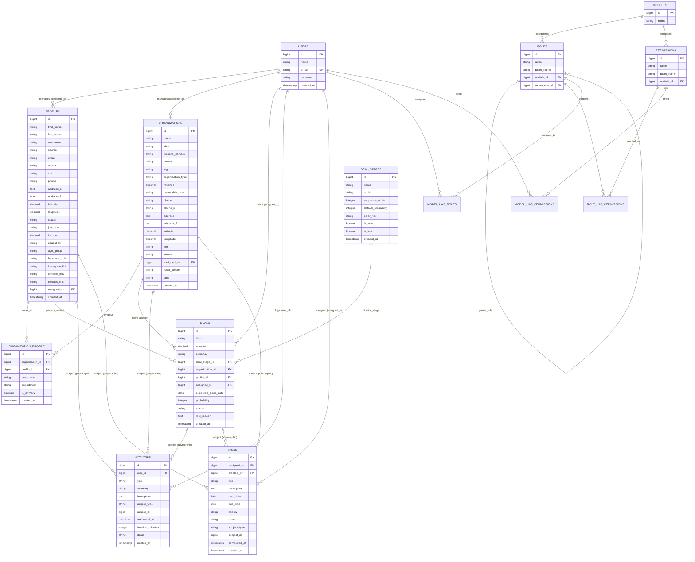

# CORK Enterprise CRM & RBAC Platform: Technical Roadmap & ERD Specification
**Document ID:** `task9october.md`  
**Target Milestone Date:** October 9, 2026 & Phase 2 Sprints  
**Stack:** Laravel (v11/v12) | PHP 8.2+ | MySQL 8.0+ | Spatie RBAC  
**Frontend Architecture:** Tailwind CSS, Modular Theme Engine (`backend.layouts.theme`), Bootstrap 5 Modals, Leaflet 1.9.4, Yajra DataTables  
**Author / Engineering Lead:** AI Engineering Assistant & Development Team  

---

## Table of Contents
1. [Executive Summary & Current Architecture Baseline](#1-executive-summary--current-architecture-baseline)
2. [The Core Architectural Shift: From Siloed Entities to Unified CRM](#2-the-core-architectural-shift-from-siloed-entities-to-unified-crm)
3. [Comprehensive Mermaid ERD (Target Phase 2 Architecture)](#3-comprehensive-mermaid-erd-target-phase-2-architecture)
4. [Data Dictionary & Schema Specification](#4-data-dictionary--schema-specification)
   - 4.1 Existing Core Tables (Updated)
   - 4.2 New Phase 2 Tables
5. [End-to-End Application Business Flows (Next Flow)](#5-end-to-end-application-business-flows-next-flow)
   - Flow A: Lead Acquisition & Geolocation Pinning
   - Flow B: Contact-to-Account Association (Account-Contact Linkage)
   - Flow C: Opportunity & Deals Pipeline (Kanban Lifecycle)
   - Flow D: Omnichannel Activity Logging & Interaction Stream
   - Flow E: Task Management & Daily Sales Worklist
6. [Actionable Development Plan for October 9, 2026](#6-actionable-development-plan-for-october-9-2026)
   - Morning Sprint (09:00 - 13:00)
   - Afternoon Sprint (14:00 - 18:00)
7. [Production-Ready Laravel Code Blueprints](#7-production-ready-laravel-code-blueprints)
   - 7.1 Database Migrations
   - 7.2 Eloquent Models & Relationship Declarations
   - 7.3 Routes Definition
   - 7.4 Spatie Permissions Seeder
8. [UI/UX Architectural Standards & Theme Compliance](#8-ui-ux-architectural-standards--theme-compliance)

---

## 1. Executive Summary & Current Architecture Baseline

### 1.1 State of the System (As of October 8, 2026)
The application has successfully established the core foundation of a multi-tenant ready CRM platform:
- **Role-Based Access Control (RBAC):** Powered by Spatie Laravel-Permission, enriched with business `modules`, hierarchical role trees (`parent_role_id`), and direct user permission overrides with protected Superadmin guards.
- **Profiles (Individual Leads / Contacts):** CRUD interface with real-time Leaflet GPS pin-drop (`latitude`, `longitude`), 13-digit CNIC and 11-digit Phone validation, demographic profiling (`job_type`, `income`, `education`, `age_group`), lead acquisition sources (`source`), lifecycle statuses (`prospective`, `working`, `postponed`, `closed`), staff assignments (`assigned_to`), and social links (`facebook_link`, `instagram_link`, `linkedin_link`, `threads_link`).
- **Organizations (Corporate Accounts):** Corporate entity management with dual phone numbers, address lines, corporate tiering (`tier_1`, `tier_2`, `tier_3`), focal person details, corporate representative CNIC, revenue tracking, Leaflet GPS coordinates, lead source, status, and staff assignment.
- **Modular Theme Engine:** Centralized in [`resources/views/backend/layouts/theme.blade.php`](file:///d:/laravel/SEPT291/SEPT24/resources/views/backend/layouts/theme.blade.php), managing light/dark mode for Tailwind elements, Leaflet satellite invert filters, and Yajra DataTables pagination, sorting glyphs, search bars, and responsive table cards.
- **Header & Navigation:** Polished navbar with optimized visual spacing and divider between the Sun/Moon theme switcher and the user avatar dropdown.

---

## 2. The Core Architectural Shift: From Siloed Entities to Unified CRM

### 2.1 The Problem Statement
Currently, `profiles` and `organizations` exist as **isolated silos**:
1. An individual lead (`Profile`) cannot be linked to the company (`Organization`) they represent.
2. There is no concept of a commercial **Deal / Opportunity**; sales agents can only update static statuses (`working`, `closed`) on contact cards without tracking expected revenue, close dates, or sales pipeline stages.
3. Customer interactions (calls, meetings, emails, site visits) cannot be logged chronologically against a contact or company dossier.
4. Next follow-up tasks and reminders are not automated.

### 2.2 The Phase 2 Vision (Starting October 9)
Phase 2 transforms CORK into a complete **Enterprise CRM Pipeline & Account Management System**:
```
+---------------------------------------------------------------------------------------------------+
|                                     INCOMING LEADS & ACCOUNTS                                     |
|     +-------------------------+                           +--------------------------------+     |
|     |  Individual (Profiles)  | <--- [Pivot Relation] --->|   Company (Organizations)      |     |
|     |  - Prospective Contact  |    organization_profile   |   - Enterprise Account         |     |
|     +------------+------------+                           +---------------+----------------+     |
+------------------|--------------------------------------------------------|-----------------------+
                   |                                                        |
                   +---------------------------+----------------------------+
                                               |
                                               v
                      +--------------------------------------------------+
                      |                 DEALS / PIPELINE                 |
                      |  - Deal Value ($) | Close Date | Win Probability |
                      |  - Stages: Lead-In -> Demo -> Proposal -> Won   |
                      +------------------------+-------------------------+
                                               |
                                               v
                      +--------------------------------------------------+
                      |         ACTIVITIES & FOLLOW-UP TASKS             |
                      |  - Calls, Meetings, Site Visits, Notes           |
                      |  - Polymorphic link to Profile, Org, or Deal     |
                      +--------------------------------------------------+
```

---

## 3. Comprehensive Mermaid ERD (Target Phase 2 Architecture)



---

## 4. Data Dictionary & Schema Specification

### 4.1 Existing Core Tables (Current Baseline)
1. **`users`**: Platform administrators, sales managers, and sales reps.
2. **`roles` / `permissions` / `modules`**: Spatie RBAC tables classifying system permissions under business modules.
3. **`profiles`**: High-detail individual records storing contact info, GPS latitude/longitude, demographics, social media URLs, source, status (`prospective`, `working`, `postponed`, `closed`), and `assigned_to` foreign key pointing to `users.id`.
4. **`organizations`**: Corporate enterprise accounts storing company details, tier (`tier_1`, `tier_2`, `tier_3`), revenue, GPS latitude/longitude, source, status, focal person, representative CNIC, and `assigned_to` foreign key pointing to `users.id`.

---

### 4.2 New Phase 2 Tables

#### Table: `organization_profile` (Account-Contact Pivot)
*Represents the employment or business relationship between an individual and a company.*
| Column | Type | Attributes | Constraints / Description |
|---|---|---|---|
| `id` | `BIGINT UNSIGNED` | Auto Increment, PK | Unique record identifier |
| `organization_id` | `BIGINT UNSIGNED` | NOT NULL, Index | FK -> `organizations(id)` ON DELETE CASCADE |
| `profile_id` | `BIGINT UNSIGNED` | NOT NULL, Index | FK -> `profiles(id)` ON DELETE CASCADE |
| `designation` | `VARCHAR(100)` | NULLABLE | Job Title (e.g. "Chief Technology Officer", "Procurement Lead") |
| `department` | `VARCHAR(100)` | NULLABLE | Department (e.g. "IT", "Finance", "Executive", "Operations") |
| `is_primary` | `BOOLEAN` | DEFAULT 0 | 1 = Primary focal contact for this organization; 0 = Secondary |
| `created_at` | `TIMESTAMP` | NULLABLE | Creation timestamp |
| `updated_at` | `TIMESTAMP` | NULLABLE | Update timestamp |
*Unique Composite Index:* `UNIQUE(organization_id, profile_id)`

---

#### Table: `deal_stages` (Sales Pipeline Configuration)
*Represents configurable milestone stages in the sales lifecycle.*
| Column | Type | Attributes | Constraints / Description |
|---|---|---|---|
| `id` | `BIGINT UNSIGNED` | Auto Increment, PK | Stage ID |
| `name` | `VARCHAR(100)` | NOT NULL | Display Name (e.g. "Lead In", "Discovery Call", "Proposal Sent", "Negotiation", "Won", "Lost") |
| `code` | `VARCHAR(50)` | NOT NULL, UNIQUE | Sluggified code (e.g. `lead_in`, `discovery`, `proposal`, `won`, `lost`) |
| `sequence_order` | `INTEGER` | NOT NULL, DEFAULT 1 | Display ordering index in Kanban boards |
| `default_probability` | `INTEGER` | NOT NULL, DEFAULT 10 | Expected win probability percentage (0% to 100%) |
| `color_hex` | `VARCHAR(10)` | DEFAULT '#5b3fd4' | Theme color code for Kanban column headers and badges |
| `is_won` | `BOOLEAN` | DEFAULT 0 | Marks closing stage as Won |
| `is_lost` | `BOOLEAN` | DEFAULT 0 | Marks closing stage as Lost |
| `created_at` | `TIMESTAMP` | NULLABLE | Standard timestamps |
| `updated_at` | `TIMESTAMP` | NULLABLE | Standard timestamps |

---

#### Table: `deals` (Commercial Pipeline Opportunities)
*Represents potential sales contracts and deals being pursued by sales agents.*
| Column | Type | Attributes | Constraints / Description |
|---|---|---|---|
| `id` | `BIGINT UNSIGNED` | Auto Increment, PK | Deal ID |
| `title` | `VARCHAR(200)` | NOT NULL | Name/Title of Deal (e.g. "Enterprise CRM License - Acme Corp") |
| `amount` | `DECIMAL(15,2)` | NOT NULL, DEFAULT 0.00 | Total contract or deal value |
| `currency` | `VARCHAR(10)` | NOT NULL, DEFAULT 'USD' | Currency symbol or ISO code (USD, PKR, EUR, GBP) |
| `deal_stage_id` | `BIGINT UNSIGNED` | NOT NULL, Index | FK -> `deal_stages(id)` ON DELETE RESTRICT |
| `organization_id` | `BIGINT UNSIGNED` | NULLABLE, Index | FK -> `organizations(id)` ON DELETE SET NULL |
| `profile_id` | `BIGINT UNSIGNED` | NULLABLE, Index | FK -> `profiles(id)` ON DELETE SET NULL (Primary contact person) |
| `assigned_to` | `BIGINT UNSIGNED` | NULLABLE, Index | FK -> `users(id)` ON DELETE SET NULL (Responsible Sales Rep) |
| `expected_close_date` | `DATE` | NULLABLE | Forecasted deal closing date |
| `probability` | `INTEGER` | NOT NULL, DEFAULT 50 | Win probability (0-100%) |
| `status` | `VARCHAR(50)` | NOT NULL, DEFAULT 'open' | Enum: `open`, `won`, `lost`, `abandoned` |
| `lost_reason` | `TEXT` | NULLABLE | Explanation if deal moved to Lost (e.g. "Competitor chosen", "Budget cut") |
| `created_at` | `TIMESTAMP` | NULLABLE | Timestamp |
| `updated_at` | `TIMESTAMP` | NULLABLE | Timestamp |

---

#### Table: `activities` (Polymorphic Customer Communication Log)
*Captures every phone call, meeting, site visit, email, and internal note in a chronological timeline.*
| Column | Type | Attributes | Constraints / Description |
|---|---|---|---|
| `id` | `BIGINT UNSIGNED` | Auto Increment, PK | Activity ID |
| `user_id` | `BIGINT UNSIGNED` | NOT NULL, Index | FK -> `users(id)` (User who logged or performed the action) |
| `type` | `VARCHAR(50)` | NOT NULL | Enum: `call`, `meeting`, `email`, `note`, `sms`, `site_visit` |
| `summary` | `VARCHAR(255)` | NOT NULL | Brief subject (e.g. "Introductory discovery call with CTO") |
| `description` | `TEXT` | NULLABLE | Detailed minutes, transcript, or discussion points |
| `subject_type` | `VARCHAR(100)` | NOT NULL, Index | Polymorphic model class (`App\Models\Profile`, `Organization`, `Deal`) |
| `subject_id` | `BIGINT UNSIGNED` | NOT NULL, Index | Polymorphic primary key of the related entity |
| `performed_at` | `DATETIME` | NOT NULL | When the communication took place |
| `duration_minutes` | `INTEGER` | NULLABLE | Call or meeting duration in minutes |
| `status` | `VARCHAR(50)` | DEFAULT 'completed' | Status: `scheduled`, `completed`, `cancelled` |
| `created_at` | `TIMESTAMP` | NULLABLE | Record creation timestamp |
| `updated_at` | `TIMESTAMP` | NULLABLE | Record update timestamp |

---

#### Table: `tasks` (Action Items & Daily Reminders)
*Powers sales agent to-do lists, follow-up reminders, and SLA deadlines.*
| Column | Type | Attributes | Constraints / Description |
|---|---|---|---|
| `id` | `BIGINT UNSIGNED` | Auto Increment, PK | Task ID |
| `assigned_to` | `BIGINT UNSIGNED` | NOT NULL, Index | FK -> `users(id)` (Agent responsible for completion) |
| `created_by` | `BIGINT UNSIGNED` | NOT NULL, Index | FK -> `users(id)` (Manager or self who created task) |
| `title` | `VARCHAR(200)` | NOT NULL | Action item title (e.g. "Send revised quotation before 4 PM") |
| `description` | `TEXT` | NULLABLE | Contextual instructions or checklist items |
| `due_date` | `DATE` | NOT NULL | Task deadline date |
| `due_time` | `TIME` | NULLABLE | Optional exact deadline time |
| `priority` | `VARCHAR(30)` | NOT NULL, DEFAULT 'medium' | Enum: `low`, `medium`, `high`, `urgent` |
| `status` | `VARCHAR(30)` | NOT NULL, DEFAULT 'pending' | Enum: `pending`, `in_progress`, `completed`, `cancelled` |
| `subject_type` | `VARCHAR(100)` | NULLABLE, Index | Polymorphic model class (optional link to Profile/Org/Deal) |
| `subject_id` | `BIGINT UNSIGNED` | NULLABLE, Index | Polymorphic model ID |
| `completed_at` | `TIMESTAMP` | NULLABLE | Timestamp when marked completed |
| `created_at` | `TIMESTAMP` | NULLABLE | Record creation timestamp |
| `updated_at` | `TIMESTAMP` | NULLABLE | Record update timestamp |

---

## 5. End-to-End Application Business Flows (Next Flow)

### Flow A: Lead Acquisition & Geolocation Pinning
```
[External Source: Referral / Web / Event]
                 │
                 ▼
        [+ Add Profile Form]
                 │
                 ├── 1. Enter First/Last Name, Unique CNIC (13 digits), Phone (11 digits)
                 ├── 2. Select Source ('referral', 'facebook', 'organic', etc.)
                 ├── 3. Assign Sales Agent ('assigned_to' -> users.id)
                 ├── 4. Set Initial Status ('prospective')
                 └── 5. Interactive Leaflet Map: Click or Drag Marker to capture exact GPS Lat/Lng
                 │
                 ▼
        [Record Saved in `profiles`]
```

---

### Flow B: Contact-to-Account Association (Account-Contact Linkage)
```
       [Profile Dossier View]                     [Organization Dossier View]
                 │                                            │
                 ├── Click "Attach to Organization"           ├── Click "+ Add Affiliated Contact"
                 │                                            │
                 └───────────────────────┬────────────────────┘
                                         │
                                         ▼
                 [Modal: Link Contact to Organization]
                 - Select Company: "Apex Global Logistics"
                 - Select Contact: "Ali Khan"
                 - Designation: "Head of Procurement"
                 - Department: "Supply Chain"
                 - Checkbox: [x] Set as Primary Focal Person
                                         │
                                         ▼
                 [Stored in `organization_profile` Pivot Table]
                 - Automatically updates Organization's `focal_person` if primary
                 - Visible in both Contact Dossier and Organization Company Roster
```

---

### Flow C: Opportunity & Deals Pipeline (Kanban Lifecycle)
```
[Qualified Contact or Organization]
                 │
                 ▼
        [+ Create New Deal]
        - Title: "Enterprise Fleet Tracking Software"
        - Organization: Apex Global Logistics
        - Contact: Ali Khan (Head of Procurement)
        - Value: $45,000.00
        - Stage: "Discovery Call" (deal_stages.id = 2)
        - Assigned Rep: Sales Agent
                 │
                 ▼
  ┌────────────────────────────────────────────────────────────────────────┐
  │                           KANBAN BOARD VIEW                            │
  │  [Lead-In]  ──>  [Discovery]  ──>  [Proposal]  ──>  [Negotiation]      │
  │   $12,000         $45,000           $90,000            $150,000        │
  │   (2 cards)      (Ali Khan)        (3 cards)          (1 card)         │
  └────────────────────────────────────────────────────────────────────────┘
                 │
                 ├── Drag Card forward to [Proposal Sent]
                 │    └─ Triggers AJAX POST `/deals/{id}/move-stage`
                 │    └─ Updates `probability` to 60%
                 │    └─ Creates automated follow-up Task for Assigned Rep
                 │
                 ├── Drag Card to [Closed - Won]
                 │    └─ Modal: Confirm Final Value ($45,000)
                 │    └─ Updates Status to 'won', Organization status to 'working'
                 │
                 └── Drag Card to [Closed - Lost]
                      └─ Modal: Compulsory Reason ('Price too high', 'Competitor X won', 'Cancelled')
                      └─ Logs lost reason for management analytics
```

---

### Flow D: Omnichannel Activity Logging & Interaction Stream
```
[Any Contact, Company, or Deal Dossier]
                 │
                 ▼
   [Unified Activities Timeline Tab]
   - Shows reverse-chronological feed of all interactions
                 │
                 ├── [Button: Log Phone Call]
                 │    - Outcome: "Answered", "Left Voicemail", "Busy"
                 │    - Duration: 15 mins
                 │    - Notes: "Client agreed to see product demo on Thursday"
                 │
                 ├── [Button: Schedule Meeting]
                 │    - Meeting Date/Time: 2026-10-12 11:00 AM
                 │    - Generates corresponding Task for the host agent
                 │
                 └── [Button: Internal Sticky Note]
                      - Note: "Client CFO prefers quarterly payments"
```

---

### Flow E: Task Management & Daily Sales Worklist
```
[Sales Rep Logs into Dashboard]
                 │
                 ▼
   [My Daily Sales Worklist Widget]
   ├── [Overdue (Red Badge)]: 2 Calls overdue from yesterday
   ├── [Due Today (Indigo Badge)]:
   │    - 10:00 AM: Follow up on Apex Global Logistics Proposal
   │    - 02:30 PM: Zoom demo with Sarah Jenkins
   └── [Upcoming]: 5 tasks scheduled for this week
                 │
                 ▼
   [Checkbox Click: Mark Complete]
   - Updates `tasks.status` = 'completed'
   - Records `completed_at` = NOW()
   - Prompts: "Do you want to schedule a next follow-up action?"
```

---

## 6. Actionable Development Plan for October 9, 2026

### 6.1 Morning Sprint (09:00 - 13:00) — Account-Contact Association & Database Foundations
- [ ] **Task 1: Database Migrations Creation**
  - Create migration `2026_10_09_000001_create_organization_profile_table.php`.
  - Create migration `2026_10_09_000002_create_deal_stages_and_deals_tables.php`.
  - Create migration `2026_10_09_000003_create_activities_and_tasks_tables.php`.
  - Run `php artisan migrate`.
- [ ] **Task 2: Eloquent Model Associations**
  - Update `Profile.php`: add `organizations()` (`belongsToMany`), `deals()`, `activities()`, `tasks()`.
  - Update `Organization.php`: add `profiles()` (`belongsToMany`), `deals()`, `activities()`, `tasks()`.
  - Update `User.php`: add `assignedOrganizations()` (`hasMany`), `assignedDeals()`, `tasks()`.
  - Create models: `App\Models\DealStage`, `App\Models\Deal`, `App\Models\Activity`, `App\Models\Task`.
- [ ] **Task 3: Seed Default Pipeline Stages**
  - Seed 6 standard CRM stages: `Lead In (10%)`, `Discovery (25%)`, `Demo Scheduled (40%)`, `Proposal Sent (60%)`, `Negotiation (80%)`, `Closed Won (100%)`, `Closed Lost (0%)`.

### 6.2 Afternoon Sprint (14:00 - 18:00) — UI Integration & Kanban Pipeline
- [ ] **Task 4: Organization-Profile Linkage Modal**
  - Add an "Affiliated Organizations" tab/list on `backend.profiles.index` show modal.
  - Add an "Affiliated Contacts" roster on `backend.organizations.index` show modal with "Make Primary Contact" action.
- [ ] **Task 5: Deals Module Skeleton & Kanban View**
  - Create `DealController.php` with `index()`, `kanban()`, `store()`, `updateStage()`, `destroy()`.
  - Build `resources/views/backend/deals/kanban.blade.php` utilizing Tailwind drag-and-drop / HTML5 drag API.
  - Synchronize colors with `theme.blade.php` for seamless light/dark mode Kanban column styling.
- [ ] **Task 6: Sidebar Navigation & Route Enrollment**
  - Add "Deals Pipeline" and "Tasks & Calendar" entries into [`resources/views/backend/layouts/sidebar.blade.php`](file:///d:/laravel/SEPT291/SEPT24/resources/views/backend/layouts/sidebar.blade.php).
  - Register all web routes with RBAC middleware protection.

---

## 7. Production-Ready Laravel Code Blueprints

### 7.1 Database Migrations

#### `2026_10_09_000001_create_organization_profile_table.php`
```php
<?php

use Illuminate\Database\Migrations\Migration;
use Illuminate\Database\Schema\Blueprint;
use Illuminate\Support\Facades\Schema;

return new class extends Migration
{
    public function up(): void
    {
        Schema::create('organization_profile', function (Blueprint $table) {
            $table->id();
            $table->foreignId('organization_id')->constrained('organizations')->cascadeOnDelete();
            $table->foreignId('profile_id')->constrained('profiles')->cascadeOnDelete();
            $table->string('designation', 100)->nullable();
            $table->string('department', 100)->nullable();
            $table->boolean('is_primary')->default(false);
            $table->timestamps();

            $table->unique(['organization_id', 'profile_id'], 'org_prof_unique');
        });
    }

    public function down(): void
    {
        Schema::dropIfExists('organization_profile');
    }
};
```

#### `2026_10_09_000002_create_deal_stages_and_deals_tables.php`
```php
<?php

use Illuminate\Database\Migrations\Migration;
use Illuminate\Database\Schema\Blueprint;
use Illuminate\Support\Facades\Schema;

return new class extends Migration
{
    public function up(): void
    {
        Schema::create('deal_stages', function (Blueprint $table) {
            $table->id();
            $table->string('name', 100);
            $table->string('code', 50)->unique();
            $table->unsignedInteger('sequence_order')->default(1);
            $table->unsignedInteger('default_probability')->default(10);
            $table->string('color_hex', 10)->default('#5b3fd4');
            $table->boolean('is_won')->default(false);
            $table->boolean('is_lost')->default(false);
            $table->timestamps();
        });

        Schema::create('deals', function (Blueprint $table) {
            $table->id();
            $table->string('title', 200);
            $table->decimal('amount', 15, 2)->default(0.00);
            $table->string('currency', 10)->default('USD');
            $table->foreignId('deal_stage_id')->constrained('deal_stages')->restrictOnDelete();
            $table->foreignId('organization_id')->nullable()->constrained('organizations')->nullOnDelete();
            $table->foreignId('profile_id')->nullable()->constrained('profiles')->nullOnDelete();
            $table->foreignId('assigned_to')->nullable()->constrained('users')->nullOnDelete();
            $table->date('expected_close_date')->nullable();
            $table->unsignedInteger('probability')->default(50);
            $table->string('status', 50)->default('open'); // open, won, lost, abandoned
            $table->text('lost_reason')->nullable();
            $table->timestamps();
        });
    }

    public function down(): void
    {
        Schema::dropIfExists('deals');
        Schema::dropIfExists('deal_stages');
    }
};
```

#### `2026_10_09_000003_create_activities_and_tasks_tables.php`
```php
<?php

use Illuminate\Database\Migrations\Migration;
use Illuminate\Database\Schema\Blueprint;
use Illuminate\Support\Facades\Schema;

return new class extends Migration
{
    public function up(): void
    {
        Schema::create('activities', function (Blueprint $table) {
            $table->id();
            $table->foreignId('user_id')->constrained('users')->cascadeOnDelete();
            $table->string('type', 50); // call, meeting, email, note, sms, site_visit
            $table->string('summary', 255);
            $table->text('description')->nullable();
            $table->morphs('subject'); // creates subject_type (string) & subject_id (bigint)
            $table->dateTime('performed_at');
            $table->unsignedInteger('duration_minutes')->nullable();
            $table->string('status', 50)->default('completed');
            $table->timestamps();
        });

        Schema::create('tasks', function (Blueprint $table) {
            $table->id();
            $table->foreignId('assigned_to')->constrained('users')->cascadeOnDelete();
            $table->foreignId('created_by')->constrained('users')->cascadeOnDelete();
            $table->string('title', 200);
            $table->text('description')->nullable();
            $table->date('due_date');
            $table->time('due_time')->nullable();
            $table->string('priority', 30)->default('medium'); // low, medium, high, urgent
            $table->string('status', 30)->default('pending'); // pending, in_progress, completed, cancelled
            $table->nullableMorphs('subject'); // optional link to Profile, Organization, or Deal
            $table->timestamp('completed_at')->nullable();
            $table->timestamps();
        });
    }

    public function down(): void
    {
        Schema::dropIfExists('tasks');
        Schema::dropIfExists('activities');
    }
};
```

---

### 7.2 Eloquent Models & Relationship Declarations

#### `app/Models/Deal.php`
```php
<?php

namespace App\Models;

use Illuminate\Database\Eloquent\Factories\HasFactory;
use Illuminate\Database\Eloquent\Model;
use Illuminate\Database\Eloquent\Relations\BelongsTo;
use Illuminate\Database\Eloquent\Relations\MorphMany;

class Deal extends Model
{
    use HasFactory;

    protected $fillable = [
        'title',
        'amount',
        'currency',
        'deal_stage_id',
        'organization_id',
        'profile_id',
        'assigned_to',
        'expected_close_date',
        'probability',
        'status',
        'lost_reason',
    ];

    protected $casts = [
        'amount' => 'decimal:2',
        'expected_close_date' => 'date',
        'probability' => 'integer',
    ];

    public function stage(): BelongsTo
    {
        return $this->belongsTo(DealStage::class, 'deal_stage_id');
    }

    public function organization(): BelongsTo
    {
        return $this->belongsTo(Organization::class, 'organization_id');
    }

    public function profile(): BelongsTo
    {
        return $this->belongsTo(Profile::class, 'profile_id');
    }

    public function assignedUser(): BelongsTo
    {
        return $this->belongsTo(User::class, 'assigned_to');
    }

    public function activities(): MorphMany
    {
        return $this->morphMany(Activity::class, 'subject');
    }

    public function tasks(): MorphMany
    {
        return $this->morphMany(Task::class, 'subject');
    }
}
```

#### Additions to [`app/Models/Profile.php`](file:///d:/laravel/SEPT291/SEPT24/app/Models/Profile.php)
```php
    // In App\Models\Profile:

    public function organizations()
    {
        return $this->belongsToMany(Organization::class, 'organization_profile')
                    ->withPivot(['designation', 'department', 'is_primary'])
                    ->withTimestamps();
    }

    public function deals()
    {
        return $this->hasMany(Deal::class, 'profile_id');
    }

    public function activities()
    {
        return $this->morphMany(Activity::class, 'subject');
    }

    public function tasks()
    {
        return $this->morphMany(Task::class, 'subject');
    }
```

#### Additions to [`app/Models/Organization.php`](file:///d:/laravel/SEPT291/SEPT24/app/Models/Organization.php)
```php
    // In App\Models\Organization:

    public function profiles()
    {
        return $this->belongsToMany(Profile::class, 'organization_profile')
                    ->withPivot(['designation', 'department', 'is_primary'])
                    ->withTimestamps();
    }

    public function deals()
    {
        return $this->hasMany(Deal::class, 'organization_id');
    }

    public function activities()
    {
        return $this->morphMany(Activity::class, 'subject');
    }

    public function tasks()
    {
        return $this->morphMany(Task::class, 'subject');
    }
```

#### Additions to [`app/Models/User.php`](file:///d:/laravel/SEPT291/SEPT24/app/Models/User.php)
```php
    // In App\Models\User:

    public function assignedOrganizations()
    {
        return $this->hasMany(Organization::class, 'assigned_to');
    }

    public function assignedDeals()
    {
        return $this->hasMany(Deal::class, 'assigned_to');
    }

    public function assignedTasks()
    {
        return $this->hasMany(Task::class, 'assigned_to');
    }
```

---

### 7.3 Routes Definition ([`routes/web.php`](file:///d:/laravel/SEPT291/SEPT24/routes/web.php))
```php
    // Deals & Pipeline Routes
    Route::prefix('deals')->name('deals.')->group(function () {
        Route::get('/', [DealController::class, 'index'])->name('index');
        Route::get('/kanban', [DealController::class, 'kanban'])->name('kanban');
        Route::get('/data', [DealController::class, 'data'])->name('data');
        Route::post('/', [DealController::class, 'store'])->name('store');
        Route::get('/{id}/edit', [DealController::class, 'edit'])->name('edit');
        Route::post('/{id}/update', [DealController::class, 'update'])->name('update');
        Route::post('/{id}/move-stage', [DealController::class, 'moveStage'])->name('moveStage');
        Route::delete('/{id}', [DealController::class, 'destroy'])->name('destroy');
    });

    // Activities & Interaction Logs
    Route::prefix('activities')->name('activities.')->group(function () {
        Route::post('/store', [ActivityController::class, 'store'])->name('store');
        Route::get('/timeline/{type}/{id}', [ActivityController::class, 'timeline'])->name('timeline');
    });

    // Tasks & Daily Sales Worklist
    Route::prefix('tasks')->name('tasks.')->group(function () {
        Route::get('/', [TaskController::class, 'index'])->name('index');
        Route::post('/store', [TaskController::class, 'store'])->name('store');
        Route::post('/{id}/toggle-complete', [TaskController::class, 'toggleComplete'])->name('toggleComplete');
        Route::delete('/{id}', [TaskController::class, 'destroy'])->name('destroy');
    });
```

---

### 7.4 Spatie Permissions Seeder
```php
$crmPermissions = [
    'deals.view', 'deals.create', 'deals.edit', 'deals.delete', 'deals.move_stage',
    'activities.view', 'activities.create', 'activities.delete',
    'tasks.view', 'tasks.create', 'tasks.edit', 'tasks.complete',
];

$salesModule = Module::firstOrCreate(['name' => 'Sales & Pipeline']);

foreach ($crmPermissions as $permName) {
    Permission::firstOrCreate([
        'name' => $permName,
        'guard_name' => 'web',
        'module_id' => $salesModule->id,
    ]);
}
```

---

## 8. UI/UX Architectural Standards & Theme Compliance

To ensure complete visual and architectural continuity with the work completed on October 8:

1. **Modular Theme Integration:**
   - All new Blade views (`deals/kanban.blade.php`, `tasks/index.blade.php`) must rely on [`resources/views/backend/layouts/theme.blade.php`](file:///d:/laravel/SEPT291/SEPT24/resources/views/backend/layouts/theme.blade.php).
   - Never write inline background color overrides; use CSS variables and standard dark utility classes (`bg-white dark:bg-[#1a1829] text-gray-900 dark:text-gray-100 border-gray-200 dark:border-gray-800`).

2. **Kanban Column Aesthetics:**
   - Kanban stage columns must adapt to dark mode with glassmorphic cards (`bg-gray-50/80 dark:bg-[#141224] rounded-2xl p-3 border border-gray-200/70 dark:border-gray-800/80`).
   - Cards must feature stage color accents, deal value badge, assigned rep avatar, and quick action icons.

3. **Leaflet Map Upgrades:**
   - When viewing an organization dossier, the Leaflet map should simultaneously render the organization's corporate headquarters pin AND secondary markers for affiliated profile contacts in the vicinity.

4. **Yajra DataTables Consistency:**
   - Any new tabular views (e.g. Deals Table view, Tasks view) must utilize the dark-themed DataTables CSS classes already implemented in `theme.blade.php`, including the purple active pagination `#5b3fd4`, zebra striping, and custom status pills.

---

*End of Specification — Prepared for Execution on October 9, 2026.*
